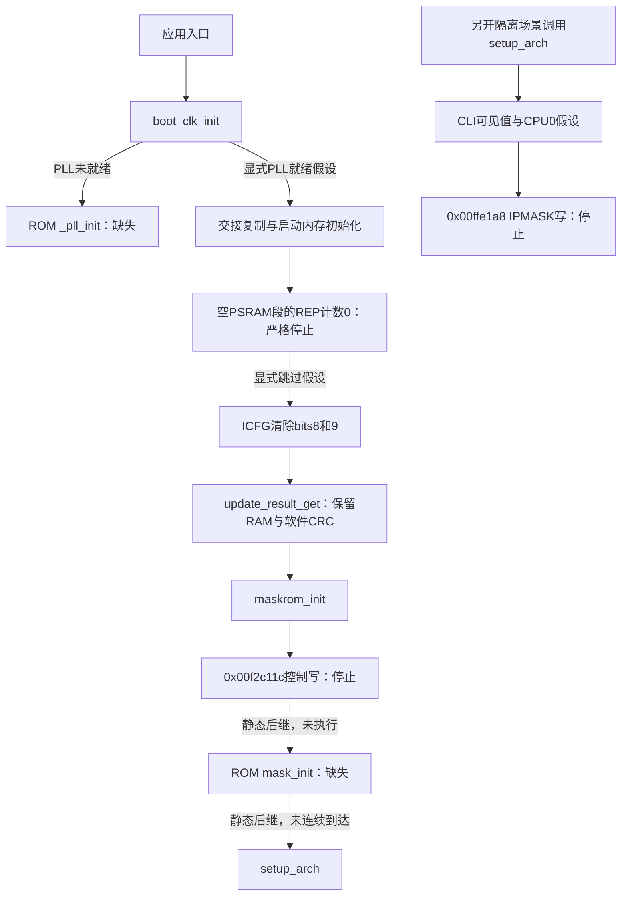

# 离线仿真探索的实际边界

2026-11-10，完成本轮“看看实际边界在哪里”的探索：**现有环境可检查真实函数、启动内存和升级结果处理；完整启动仍需要控制寄存器、内部ROM和中断体系模型。** 本轮把严格停止、显式假设续探、单独阶段调用分开记录，共13个可复现用例。没有刷机、ROM空函数、未知寄存器假读值或被忽略的控制写入，也没有启动RTOS。

工具：[tools/probe_boot_boundaries.py](../tools/probe_boot_boundaries.py)，结果：[evidence/boot-boundaries.json](../evidence/boot-boundaries.json)。检查只在本机执行，GitHub Actions保持停用。原[第一轮](boot-exploration.md)、[第二轮](boot-handoff.md)报告保持可复现，没有把历史停止改成通过。

## 现在有证据覆盖什么

| 能力 | 已做到 | 结果的含义 |
| --- | --- | --- |
| 输入和封装 | 精确官方包／应用SHA、容器CRC、补丁地址和布局检查 | 可拒绝错包、损坏、历史r2的越界跳转 |
| 函数执行 | 实际编译产物、参数／寄存器／栈和明确API桩 | 检查已覆盖路径的代码行为；DSP／RTOS桩仍有边界 |
| 交接和启动内存 | 对齐结构、未知字节跟踪、BSS／data／RAM代码摘要 | 在明确初始条件与循环模型下验证初始化结果 |
| 升级结果处理 | 执行QCY自身CRC例程和有效／无效结果分支，80B清理 | 未用主机CRC返回值代替固件函数；主机标准库只作独立断言 |
| 完整启动与硬件 | 在真实控制地址写入前停止 | 未执行控制寄存器副作用、ROM、异常／中断／双核、蓝牙和声音 |

以下执行均使用官方0.1.1.8精确字节；没有为了模拟修改固件。当前耳机继续使用已恢复验收的b79 ANC镜像。

## 启动路径和停止位置



连续启动的显式假设路径在 `0x060664c4` 尝试向 `0x00f2c11c` 写0时停止。参考`os_cpu_c_v2.c.o`的IR同样先向这个volatile地址写0、再写0x17，然后调用`mask_init(NULL, log_putbyte)`。**尚未确定该控制地址的具体硬件归属和副作用，不能把它当普通RAM或随意命名为某个SPI／UART寄存器。** QCY后继call可直接解码为ROM `0x0001fde8`；本轮没有执行到该call，也没有用假返回越过它。

为区分后续阶段的依赖，另建一次`setup_arch`的隔离调用：初始BSS／data／RAM代码直接来自已验证的初始化输出，**它不是失败启动的续跑，也不证明ROM调用可以省略**。实际例程先处理定时器中断使能，通过RAM中的IRQ临界区辅助例程，在 `0x0012b56c` 尝试给 `0x00ffe1a8` 写6。参考`csfr.h`能确定这是CPU0的`IPMASK`：`0xff0000+0xe000+0x6a*4`。仅模拟CLI的可见bit9效果不能替代优先级屏蔽、pending、路由和中断交付。

## 分支命名的依据

用固定SDK `startup.S.o`与QCY入口做自动匹配：170B启动代码有18个重定位，屏蔽各自32位立即数字段后，剩余 **98B全部相同**。读取参考符号并解析QCY机器码，得到`boot_clk_init`、`boot_info_init`、`update_result_get`、`maskrom_init`、`setup_arch`及各内存段地址。

同一对象的`__cpu_irq_disabled`与QCY RAM函数`0x0012cb08`比较，36B中去掉4B指针重定位，剩余 **32B全部相同**。该例程确实含24B、计数2的`rep.i`，循环体中含`rts`。这些是参考符号到实际指令的匹配证据，不表示拿到了QCY原工程、所有函数完全相同或芯片控制语义已验证。

## REP与ICFG：严格边界和假设路径

严格默认仍在零计数`rep`停止。固定版本社区[QEMU实现](https://github.com/simonjohansson/fm1-emulator/blob/519a13b879d744f5c05bfe3c4e5d4e04d8d4ae34/src/target/pi32v2/helper.c)选择零计数跳过，其[模拟器测试](https://github.com/simonjohansson/fm1-emulator/blob/519a13b879d744f5c05bfe3c4e5d4e04d8d4ae34/tests/test_repeat.py)也覆盖这一政策；这不是BR28硬件测量。上游ISA资料仍[保留零计数未验证](https://github.com/jvitkauskas/pi32v2-isa/blob/3608ed19bc21324f8ecfe79cc0018d05e43d9563/docs/GAPS.md)。本项目只在新命名诊断场景中显式选择skip，没有放开旧默认。

新增假设路径还需要：

- ICFG的可见值可读写；未知初值会单独停下，不能偷偷套用FM-1测得常量。
- 对两种给定初值0x300、0x01090700，执行实际掩码后分别为0、0x01090400，只清除bits8/9，其余位保留；没有模拟运行模式或真实IRQ。
- `__cpu_irq_disabled`中`rep.i`体末的`rts`按“返回并结束本次重复”处理，单独计数并标为假设。旧场景仍会在该指令停止。
- 在隔离`setup_arch`中，CLI只使用上游已测的可见bit9模型，CPU号显式为0；IPMASK写入仍拒绝。

对大计数再做敏感性试验：完整倒计数、每段最多7次、每段最多256次。分块时保留R2剩余值，由**固件自己的后跳分支**重新进入`rep`，不改程序。三个模型分别用17251、20297、17331步到达同一控制写边界，BSS／data／RAM代码／升级结果一致。这表明本轮结果对这三种假设不敏感，**没有证明真实BR28采用其中任何一个模型，也没有覆盖所有可能的循环、异常和时序行为**。

## 保留RAM和实际CRC路径

`update_result_get`读取 `0x0019fb80` 起的保留区，符合参考链接定义 `_MASK_MEM_BEGIN - 0x80`。当前新鲜RAM未知时，第一次真正读取数据在`0x0019fb8a`停止。不能把冷开机、OTA重启和普通复位的这块内容一律当0。

分别提供合成的“空参数／有效CRC／错误CRC”，实际运行QCY的软件CRC代码，计算78B负载，再执行结果分支和20次逐字清零。独立用`binascii.crc_hqx`比较固件算出的CRC：

| 输入 | 合成结果／标志 | 写入QCY状态字`0x00126718` |
| --- | --- | --- |
| 空参数 | 全0 | `0x00005a00` |
| CRC有效 | 结果0x5a01，标志2 | `0x00025a01` |
| 相同负载、CRC翻转1bit | 结果0x5a01，标志2 | `0x00025a00`，不接受负载中的结果码 |

返回后，`0x0019fb88..0x0019fbd8`的80B全部清0，栈恢复；128B窗口中的其他48B仍未知。BSS摘要还验证了除结果字外无其他变化，data和RAM代码保持原复制结果。测试输入不来自设备日志或私有备份，不能当成真实升级现场。

## 十三组用例与复现

```bash
python3 tools/check_local.py
# 只运行这一轮：
python3 tools/probe_boot_boundaries.py --report analysis/boot-boundaries/results.json
# 可选：下载固定参考材料，在本机提取IR并验证重定位匹配
python3 tools/fetch_boot_reference.py --decode-ir --output-dir analysis/boot-reference
python3 tools/probe_boot_boundaries.py \
  --startup-object analysis/boot-reference/startup.S.o \
  --report analysis/boot-boundaries/with-reference.json
```

| 用例 | 模型step | 停止位置 |
| --- | ---: | --- |
| 严格零计数 | 16077 | `0x06000182`，REP行为未验证 |
| 假设skip，未适配／未提供ICFG | 各16079 | `0x0600018a`，区分模型和初态缺口 |
| ICFG已提供，IRQ辅助REP保持严格 | 16099 | `0x0012cb12` |
| IRQ辅助REP显式假设，保留RAM未知 | 16116 | `0x06000ee0`，读取0x0019fb8a |
| 空保留参数 | 17248 | `0x060664c4`，控制写拒绝 |
| 有效参数／无效CRC | 17251／17250 | 同上，结果码不同 |
| 另一ICFG初值 | 17251 | 同上，掩码外位保留 |
| REP分块7／256 | 20297／17331 | 同上，最终内存一致 |
| 隔离setup，CLI保持严格 | 10 | `0x0012b55c` |
| 隔离setup，只适配CLI可见值 | 15 | `0x0012b56c`，IPMASK写拒绝 |

公开结果仅保存每例最后12条指令、最多8条内存事件、语义检查点、初始化覆盖和摘要；没有完整RAM写入镜像。两组参考对象`crc16.c.o`、`os_cpu_c_v2.c.o`的固定摘要，以及QEMU源策略的提交／摘要已记在依赖清单。所有库／IR／外部源码只在忽略目录中，未复制或链接QEMU实现。

## 探索收敛后的选择

继续做EQ修改前的**函数和受控场景验证**，现有工具可以使用：控制流范围、ABI、栈、状态复制、内存摘要、错误输入分支都能检查。每次仍需列出外部API和初态假设。

若目标升级为**可信的完整耳机启动仿真**，下一阶段必须补充具体证据和模型：内部ROM的`_pll_init`／`mask_init`实现或完整调用契约；0x00f2c11c等控制地址的定义和副作用；ICFG／IPMASK／异常向量／IRQ交付和双核行为；真实loader交接、保留RAM及校准来源；再到时钟、定时器、看门狗、蓝牙和音频。原有Flash备份不能补齐内部ROM、启动时RAM和这些硬件行为。

本轮在上述两处控制写和ROM静态后继处收敛。继续放入空函数或通用寄存器存储即可让PC前进，但无法增加对真实启动的验证依据。当前结果不能单独批准新固件刷写；历史r2仍被拒绝，完整耳机启动、配对和声音仍未模拟。
